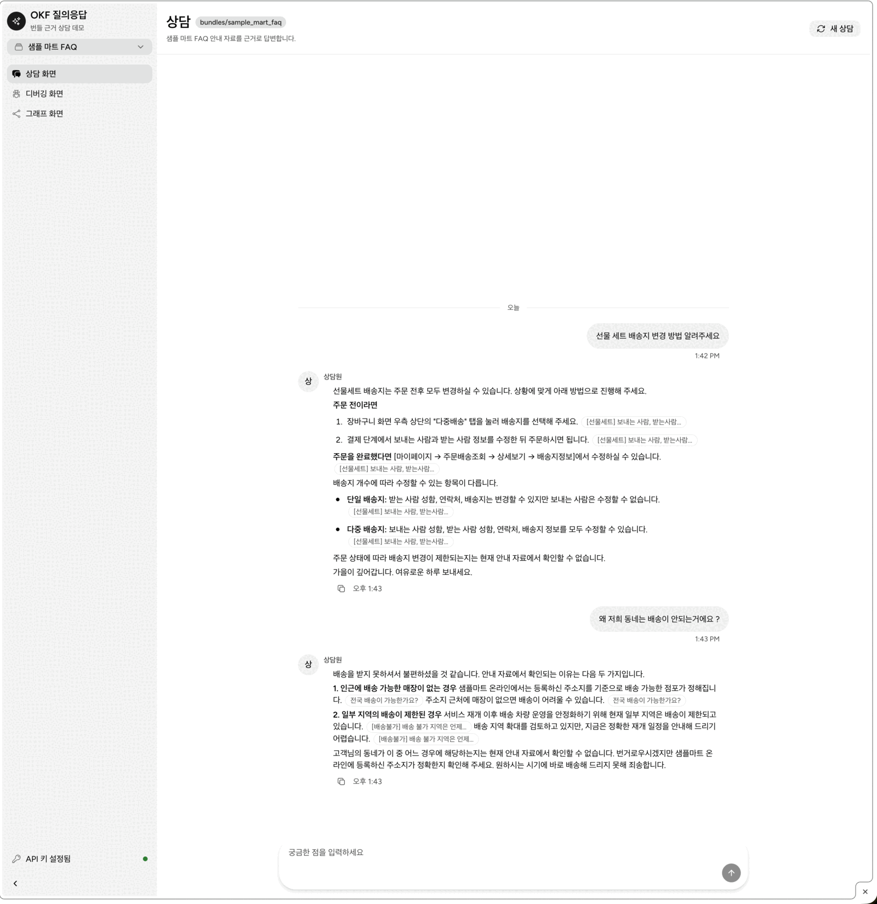
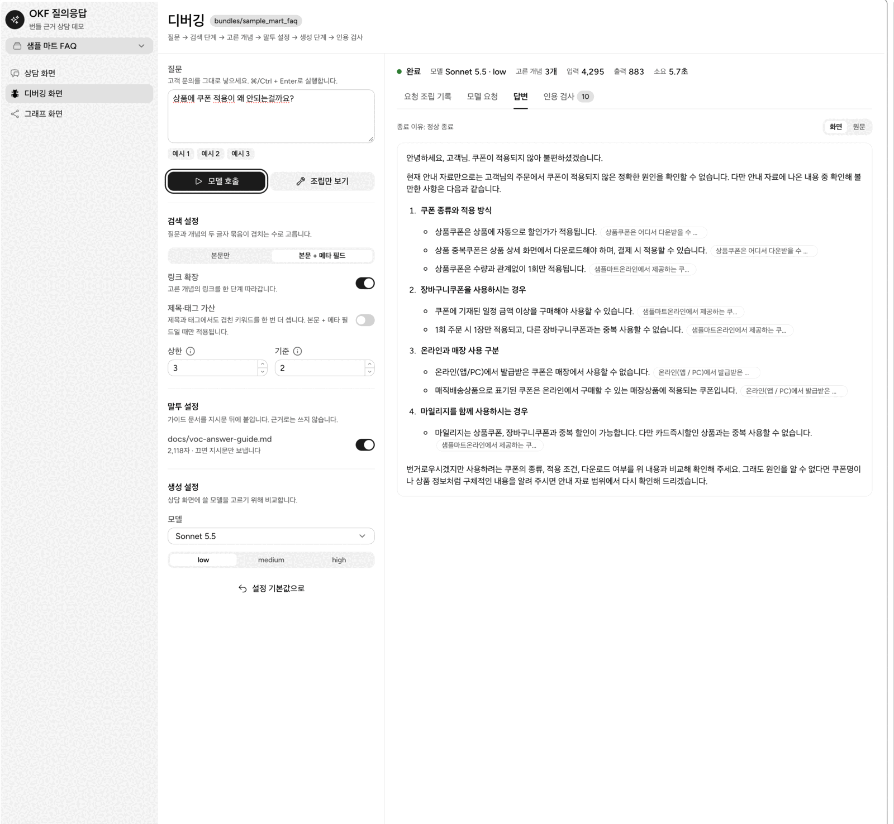
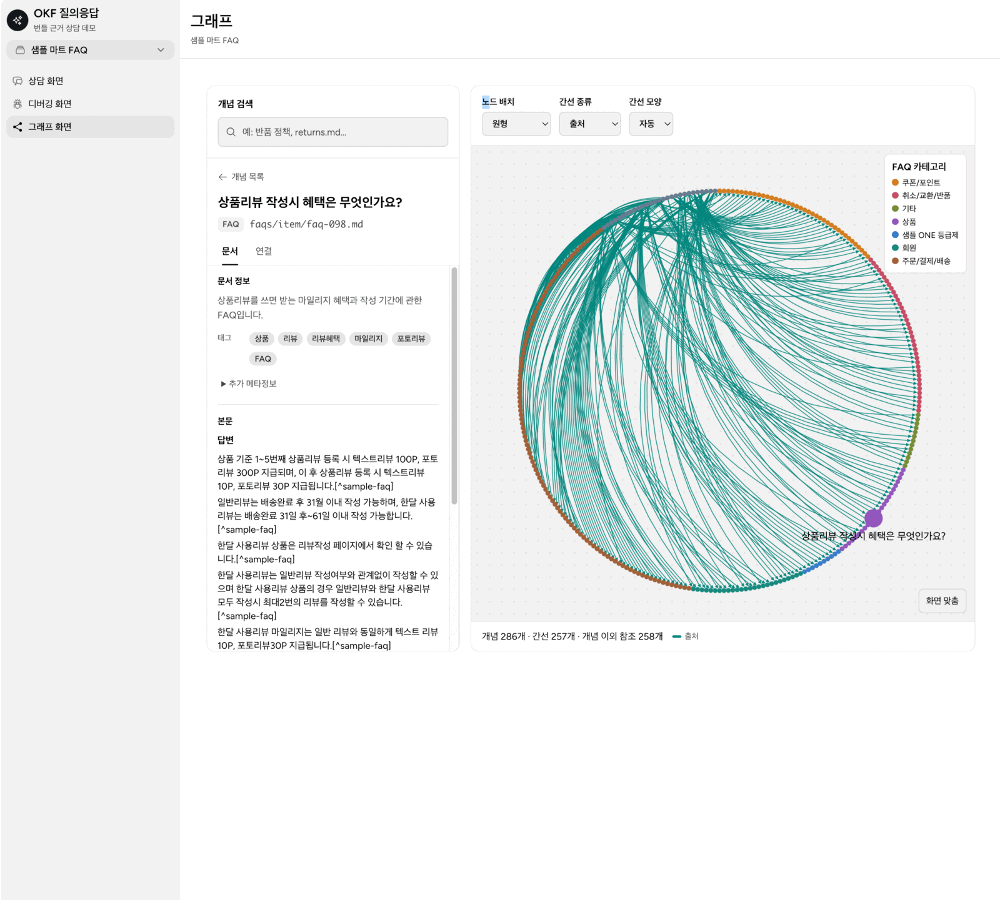

# okf-playbook

Learn Open Knowledge Format (OKF) by building a knowledge bundle and answering questions with cited sources.

OKF(Open Knowledge Format) v0.3을 공부하면서 지식 번들을 만들고, 그 번들을 근거로 질문에 답하는 실습 저장소다. 번들 검증·검색·프롬프트 조립·인용 검사·출처 추적·신뢰 등급·그래프를 `src/okf/`에 TypeScript로 구현했고, CLI와 웹 화면이 같은 코드를 쓴다.

## 웹 화면

좌측 메뉴에서 번들을 고르고 상담·디버깅·그래프 화면을 오간다. `bundles/` 아래 번들은 자동으로 목록에 뜬다.

### 상담 화면

고객 상담원처럼 번들 내용만 근거로 답한다.

- 답변 문장마다 근거가 된 FAQ 제목이 인용 칩으로 붙는다. 칩에 마우스를 올리면 전체 제목이 보인다.
- 번들에서 확인할 수 없는 내용은 "현재 안내 자료에서 확인할 수 없습니다"라고 말하고 지어내지 않는다.
- 대화는 번들별로 브라우저에 저장되어 다른 화면에 다녀와도 남아 있다. 새로 시작하려면 **새 상담**을 누른다.
- 답변 아래에서 복사 버튼과 답변 시각을 볼 수 있다.

### 디버깅 화면

질문 → 검색 단계 → 고른 개념 → 말투 설정 → 생성 단계 → 인용 검사까지 과정을 하나씩 열어 본다.

- **검색 설정**: 본문만 / 본문 + 메타 필드, 링크 확장, 제목·태그 가산, 고를 개념의 상한과 기준 점수를 바꿔 가며 결과를 비교한다.
- **말투 설정**: `docs/voc-answer-guide.md` 같은 가이드 문서를 지시문 뒤에 붙인다. 근거로는 쓰지 않는다.
- **생성 설정**: 모델(Sonnet 등)과 추론 강도(low·medium·high)를 골라 상담 화면에 쓸 모델을 정한다.
- 결과 영역에는 고른 개념 수, 입력·출력 토큰, 소요 시간이 나오고 **요청 조립 기록 · 모델 요청 · 답변 · 인용 검사** 탭으로 나뉜다. 답변은 화면 렌더링과 원문을 전환해 볼 수 있다.
- API 키 없이도 **조립만 보기**로 프롬프트가 어떻게 만들어지는지 확인할 수 있다.

### 그래프 화면

번들 안 개념 사이의 링크와 출처(`sources`) 관계를 Sigma.js 그래프로 그린다.

- 노드 배치(원형 등), 간선 종류(출처·링크), 간선 모양을 바꿀 수 있다. 노드 색은 FAQ 카테고리를 나타낸다.
- 왼쪽에서 개념을 검색하거나 노드를 누르면 문서 정보(설명·태그·메타데이터)와 본문, 연결된 개념을 볼 수 있다.
- 하단에 개념·간선·개념 이외 참조 수가 표시된다.

## 번들

| 경로 | 내용 |
| --- | --- |
| `bundles/knowledge/` | 반품·환불 정책과 절차를 담은 실습 번들 |
| `bundles/sample_mart_faq/` | 테스트용 마트 FAQ를 OKF v0.3으로 옮긴 번들 (FAQ, 주제 허브, 원본 자료) |

새 번들은 `bundles/<이름>/`에 두고 `index.md`에 `okf_version`을 넣는다.

## 웹 화면 로컬 실행

저장소 루트에서 `pnpm install`로 웹과 서버 의존성을 설치한 뒤 [.env.example](.env.example)을 저장소 루트의 `.env`로 복사하고 `ANTHROPIC_API_KEY`를 설정한다. 기존 `.env`에 `VITE_ANTHROPIC_API_KEY`가 있다면 변수 이름을 바꾼다.

웹과 서버의 전용 의존성은 각각 `web/package.json`과 `server/package.json`에서 관리한다.

각각 다른 터미널에서 `pnpm dev:api`와 `pnpm dev`를 실행하고 Vite가 출력한 로컬 주소를 연다. Vite는 `/api` 요청을 `127.0.0.1:3001`의 Express로 전달한다. OKF 검색과 프롬프트 조립은 브라우저에서 실행한다. 키 없이 실행하면 디버깅 화면에서 프롬프트 조립을 확인할 수 있다.

`web/` 또는 `server/`에서 직접 실행할 때도 `pnpm dev`를 사용한다.

## CLI

Node 22.18 이상에서 TypeScript를 바로 실행한다.

| 명령 | 하는 일 |
| --- | --- |
| `pnpm validate [dir]` | 번들 검증 (기본값 `bundles/knowledge`) |
| `pnpm retrieve "질문"` | 질문에 맞는 개념과 고른 이유, 신뢰·주의 표시 |
| `pnpm prompt "질문"` | 모델에 붙여 넣을 프롬프트 출력 |
| `pnpm check-answer "질문" answers/qN.txt` | 저장한 답변의 인용 검사 |
| `pnpm compare` | 질문 목록 × 검색 설정 비교표 |
| `pnpm trace policies/returns.md` | 개념의 출처를 원문까지 따라가기 |
| `pnpm graph [--mermaid]` | 번들 그래프 출력 |
| `pnpm test` · `pnpm typecheck` | 테스트와 타입 검사 |

## Docs

학습·실습 계획과 회차별 노트는 [docs/](docs/README.md)에서 관리한다. 모듈 구조는 [docs/okf-modules.md](docs/okf-modules.md), 용어는 [GLOSSARY.md](GLOSSARY.md)에 있다.
