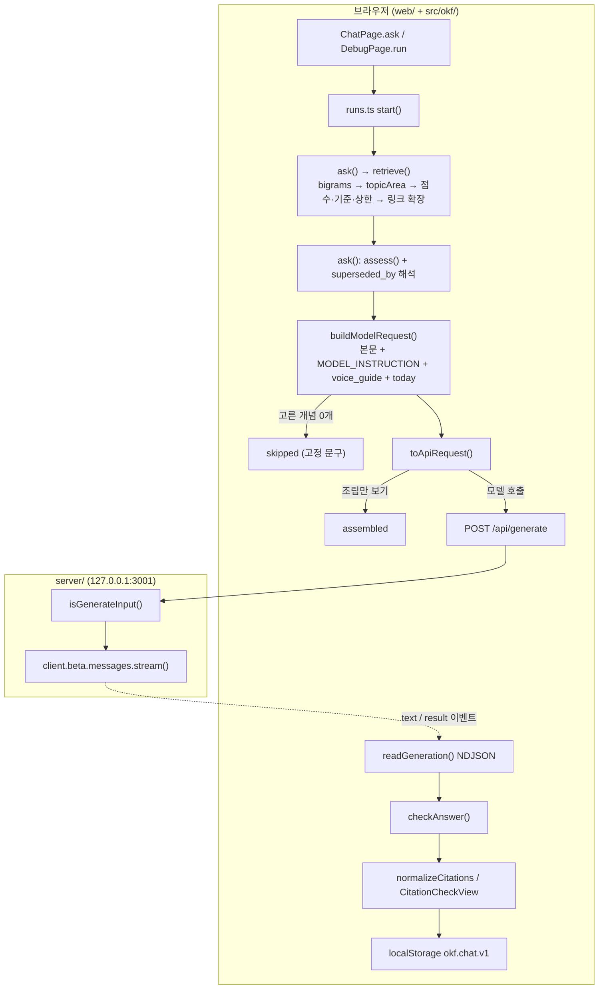

# 질문에서 답변까지: 처리 순서와 고도화 지점

질문 하나가 웹 화면에서 답변이 되기까지 어떤 함수가 어떤 순서로 도는지 정리한다. 단계마다 지금 하는 일과 비어 있는 곳(고도화 후보)을 같이 적었다. 용어는 [GLOSSARY.md](../GLOSSARY.md)를 따른다. 모듈별 역할과 CLI 흐름은 [src/okf 모듈 구조](okf-modules.md)에 있다.

기준 시점은 2026-11-20, 커밋 `fbff55e`다. 코드를 바꾸면 이 문서의 단계 설명과 요약표도 함께 고친다.

## 1. 한눈에 보기

실제 순서는 다음과 같다.

**번들 적재 → 검색 단계(`retrieve`: bigram 분해 → 주제 허브 가산 → 점수·기준·상한 → 링크 확장) → 신뢰 판정(`assess`) → 모델 요청 조립(지시문 + 말투 설정 + 날짜 + 본문) → API 파라미터 변환 → 생성 단계(스트리밍) → 인용 검사 → 화면 표시 → 대화 기록 저장**

흔히 "질문 분석 → 검색 → 개념 선택 → 말투 설정·보정 → 생성 → API 호출 → 인용 검사"로 짐작하는데, 세 군데가 다르다.

1. 질문 분석은 따로 있는 단계가 아니다. `retrieve()` 안에서 `bigrams()`가 질문을 두 글자 묶음으로 쪼개는 게 전부다.
2. 검색과 개념 선택은 `retrieve()` 한 함수 안에서 같이 일어난다. 짐작에 없던 주제 허브(Topic) 가산과 링크 확장이 여기 들어 있고, 선택이 끝나면 `ask()`가 신뢰 판정을 붙인다.
3. 말투는 설정만 있고 보정은 없다. 말투 설정은 생성 전에 system에 `<voice_guide>`로 들어갈 뿐이다. 생성 뒤에 바뀌는 건 화면 표시용 인용 정리뿐이고, 저장된 답변 텍스트는 그대로다.

OKF 처리는 전부 브라우저에서 돈다. Express 서버(`server/`)는 API 키를 들고 Claude 호출만 중계하며, 번들을 보지 않는다.

## 2. 단계별 처리

### 2-1. 번들 적재 (질문 전에 한 번)

- 웹: `web/src/config/bundles.ts`가 `import.meta.glob`으로 `bundles/*/**/*.md`를 빌드할 때 문자열로 가져온다. `loadBundles()`는 루트 `index.md`에 `okf_version`이 없는 번들을 빼고, 흔적으로는 `console.warn` 한 줄만 남긴다. 남은 번들마다 검색 설정(`{...DEFAULT_OPTIONS, ...BUNDLE_SETTINGS[id].retrieval}`)과 말투 설정(기본값 `docs/voc-answer-guide.md`)을 붙인다.
- CLI: `src/okf/load.ts`의 `loadBundle()`이 디렉터리를 재귀로 읽는다. `okf_version` 검사는 하지 않는다.
- 고도화 포인트: 번들을 "경로 → 문자열 Map"으로만 들고 있어서 질문마다 YAML을 다시 파싱한다. 여기서 `Concept[]`, 개념별 bigram 집합, IDF 표 같은 검색 인덱스를 미리 만들어 두면 성능과 IDF 가중치 도입이 함께 풀린다.

### 2-2. 실행 시작 (`web/src/features/qa/runs.ts`의 `start()`·`prepare()`)

- 생성 중인 실행이 있으면 `stop()`으로 중단한다. 실행은 늘 하나만 돈다.
- `prepare()`가 `ask()` → `buildModelRequest()` → `toApiRequest()`를 동기로 부른다.
- 고도화 포인트: LLM 질문 재작성, rerank, 임베딩 검색처럼 비동기 단계를 넣으려면 먼저 `ask()`·`prepare()`를 async로 바꿔야 한다. "검색 중" 같은 새 phase도 필요하다.

### 2-3. 검색 단계 (`src/okf/retrieve.ts`의 `retrieve()`)

질문 분석, 검색, 개념 선택이 모두 이 함수 안에 있다.

- 질문 분석은 `bigrams()`다. 소문자로 바꾸고 단어마다 연속한 두 글자를 집합에 넣는다. "상품을"은 {상품, 품을}이 된다. 조사를 떼는 장치는 따로 없고, bigram이 겹쳐서 "상품"이 살아남는다. 불용어·IDF·형태소 분석·동의어 처리가 없어서 "어떻게", "있나요" 같은 흔한 말도 어느 개념에서나 점수를 얻는다. ADR 0001이 이 한계를 다음 과제로 적어 두었다.
- 주제 허브 매칭(`topicArea()`)은 `type: Topic` 개념(sample_mart_faq에 28개)의 title·tags를 질문과 비교한다. description은 일부러 보지 않는다. 하나라도 겹친 허브가 링크하는 개념은 +1을 받는다. Topic 자체는 고른 개념이 되지 않는다.
- 점수는 `total = 겹친 bigram 수 + (boostMeta면 title·tags 일치 수) + (주제 영역이면 1)`이다. 기준(`minScore`, 기본 2) 이상만 남기고 점수 내림차순으로 정렬해 상한(`maxDocs`, 기본 3)까지 자른다.
- 링크 확장은 키워드로 고른 개념의 본문 링크만 한 단계 따라가 `via: 'link'`로 더한다. 깨진 링크, 번들 밖 링크, 개념이 아닌 대상, 상한 초과는 경고로 남긴다.
- 고도화 포인트:
  - 불용어·IDF는 `score()`에서 겹친 bigram 수 대신 가중합을 쓰는 식으로 넣는 게 가장 덜 침습적이다.
  - 길이 정규화(BM25)가 없어서 긴 개념이 유리하다.
  - 상한에는 링크 확장으로 더한 개념도 들어간다. 키워드 개념이 3자리를 채우면 링크 확장은 사실상 꺼진다.
  - 검색 품질 회귀는 `pnpm compare`(q1~q8)로 본다. knowledge 번들 기준이라 sample_mart_faq용 평가 질문은 아직 없다.

### 2-4. 신뢰 판정 (`src/okf/ask.ts` 후반, `src/okf/trust.ts`의 `assess()`)

- 신뢰 등급은 `generated.at` 이후의 현재 검토 기록만 보고 정한다. 없으면 `unverified`, `human:` 기록이 있으면 `human-reviewed`, 나머지는 `machine-confirmed`다.
- `status`(draft·deprecated), `stale_after` 경과, 읽을 수 없는 `verified` 항목에는 주의를 붙인다. deprecated면 `superseded_by`를 번들 경로로 풀어 `replacement`에 담는다.
- 주의가 있어도 개념을 빼지 않는다(명세 §5.3). 대체 개념을 고른 개념에 더하지도 않는다.
- 고도화 포인트: 이 판정은 모델에 전혀 전달되지 않고, 디버깅 화면 `PickCard`의 배지로만 보인다. 가장 비어 있는 자리다. `buildModelRequest()`의 시그니처를 `AssessedPick[]`로 넓히면 `<document status="deprecated" tier="unverified">` 같은 표시를 붙일 수 있다. `ask.ts` 주석에도 "0008 실습 5단계에서 정한다"는 미결 항목으로 남아 있다.

### 2-5. 모델 요청 조립, 말투 설정 포함 (`src/okf/request.ts`의 `buildModelRequest()`)

- 고른 개념이 0개면 `request: null`을 돌려주고 끝난다. 모델은 부르지 않는다.
- 고른 순서대로 frontmatter를 떼고 본문만 `<document path="…">` 블록으로 감싼다.
- system은 `MODEL_INSTRUCTION`(8줄 규칙)이고, 말투 설정이 켜져 있으면 뒤에 `<voice_guide>`를 붙인다. 규칙에는 정책 문장마다 `[path]` 인용, 사과·인사 문장은 인용 제외, 근거가 없으면 "확인할 수 없습니다", 근거 없는 조치 약속 금지, 말투 설정보다 지시문 우선 같은 내용이 있다.
- user는 `<today>` + `<documents>` + `<question>`이다. 날짜를 user에 두는 건 system을 고정해서 캐시를 쓰려는 의도다.
- 넣은 본문의 경로를 요청 조립 기록의 `providedPaths`로 남긴다. 인용 검사가 이 목록과 비교한다.
- 고도화 포인트:
  - 모델은 path와 본문만 본다. title·description·신뢰 정보는 받지 못한다.
  - 상황별 말투 선택(불만 호소와 일반 문의)이나 생성 후 말투 점검이 없다. 생성 후 보정을 넣으려면 `runs.ts`의 `.then()` 안에서 모델을 한 번 더 부르는 구조가 된다.
  - 지시문이 코드에 고정돼 있다. 번들마다 다른 지시문을 쓰려면 `BUNDLE_SETTINGS`에 필드를 더하면 된다.

### 2-6. API 파라미터 변환 (`shared/claude/apiRequest.ts`의 `toApiRequest()`)

- `{model, max_tokens: 16000, output_config.effort, system, messages}`를 만든다. Opus와 Sonnet에는 서버 측 fallback beta를 붙인다. thinking과 temperature는 보내지 않는다.
- 같은 순수 함수가 브라우저(디버깅 화면 미리보기)와 서버(실제 호출)에서 두 번 돈다. 그래서 미리보기와 실제 요청이 일치한다.
- 고도화 포인트: system을 고정해 캐시를 쓸 수 있게 설계했지만 `cache_control`이 어디에도 없어서 캐시가 실제로 적용되지 않는다. 넣을 곳은 이 함수다.

### 2-7. 분기 (`runs.ts`의 `start()`)

- 고른 개념이 0개면 `skipped`다. 상담 화면은 고정 문구 `NO_PICKS_ANSWER`를 보여 준다.
- "조립만 보기"는 `assembled`다. 서버를 부르지 않으므로 키가 없어도 된다.
- 그 밖에는 `streaming`으로 들어가 생성을 시작한다.
- 고도화 포인트: 0개일 때 기준을 낮춰 다시 검색하거나, 가까운 주제 허브를 안내하거나, 되묻는 폴백이 없다.

### 2-8. 생성 단계 (브라우저 → 서버 → Claude)

- 브라우저 `web/src/lib/claude/generate.ts`가 `POST /api/generate`를 보내고, Vite 프록시가 `127.0.0.1:3001`로 넘긴다.
- 서버 `server/app.ts`의 `isGenerateInput()`이 입력을 엄격하게 검사한다. user 메시지 정확히 하나, 알려진 model과 effort만 통과한다. 키가 없으면 503이다.
- `server/generate.ts`가 `client.beta.messages.stream()`을 열고 텍스트 조각을 NDJSON 한 줄씩 흘려보낸다. 끝나면 `toGenerationResult()`가 text·stopReason·servedModel·fallbackUsed·usage·refusal로 정리한다.
- 고도화 포인트: 재시도, 요청 로그, 비용 집계가 없다. 멀티턴을 하려면 `ModelRequest` 타입, `isGenerateInput()`, `app.ts`를 함께 고쳐야 한다.

### 2-9. 인용 검사 (`src/okf/answer.ts`의 `checkAnswer()`)

- 스트리밍이 끝난 뒤에만 돈다. 모델이 거절했거나 중단·오류로 끝나면 건너뛴다.
- `[x.md]`와 `[a.md, b.md]` 꼴만 인용으로 센다. 결과는 네 가지다.
  - `cited`: 인용한 개념
  - `unknownCitations`: 주지 않은 개념을 인용한 것, 곧 지어낸 근거
  - `uncitedSentences`: 인용이 없는 문장
  - `noEvidence`: "확인할 수 없/확인하기 어렵"이 답변 어딘가에 있는지. 문장별이 아니라 답변 전체로 본다.
- 고도화 포인트: 인용한 개념에 정말 그 내용이 있는지(사실 확인)는 보지 않는다. 큰 빈자리다. bigram 겹침 휴리스틱부터 LLM 판정까지 단계적으로 넣을 수 있다. `unknownCitations`가 나왔을 때 다시 생성하는 로직은 `runs.ts`의 `.then()`에 들어갈 자리다. 출처를 원문 개념까지 따라가는 `provenance.ts`의 `trace()`는 지금 CLI에서만 쓰인다.

### 2-10. 화면 표시 (`web/src/features/qa/citations.ts`의 `normalizeCitations()`)

- `[a.md, b.md]`를 `[a.md][b.md]`로 나눠 인용 칩으로 그린다.
- 상담 화면은 지어낸 인용을 `keepOnly`로 조용히 숨긴다. 인용 검사 결과는 고객에게 보이지 않고, 표시에도 생성 흐름에도 영향을 주지 않는다.
- 디버깅 화면은 탭 4개(요청 조립 기록, 모델 요청, 답변, 인용 검사)에서 빨간 배너와 "확인 필요" 목록으로 보여 준다.

### 2-11. 대화 기록 (`chat/session.ts`, `chat/history.ts`)

- localStorage `okf.chat.v1`에 번들당 50턴까지 저장한다. phase가 바뀔 때만 저장한다.
- 고도화 포인트: 이전 턴은 검색 단계에도 모델 요청에도 들어가지 않는다. 그래서 "그럼 할인 상품은요?" 같은 후속 질문은 앞 대화 맥락 없이 처리된다.

## 3. 단계별 요약표

| # | 단계 | 파일 / 함수 | 지금 하는 일 | 비어 있는 것 (개선 후보) |
|---|---|---|---|---|
| 1 | 번들 적재 | `loadBundles()`, `loadBundle()` | .md를 문자열로 읽고 번들별 설정을 붙임 | 검색 인덱스·캐시 없음, CLI 버전 검사 없음 |
| 2 | 실행 시작 | `runs.ts` `start()`·`prepare()` | 이전 실행 중단, 동기로 검색·조립 | 비동기 단계를 넣을 구조 없음 |
| 3-1 | 질문 분석 | `retrieve.ts` `bigrams()` | 소문자화 + 단어 안 bigram | 불용어, IDF, 동의어, 형태소 분석, 질문 재작성 |
| 3-2 | 주제 허브 | `topicArea()` | title·tags가 맞는 허브의 영역이면 +1 | 일치 강도와 상관없이 +1 고정 |
| 3-3 | 점수·선택 | `score()`, `retrieve()` | bigram 수 + 가산, 기준·상한 | BM25, 의미 검색, sample_mart_faq용 평가 질문 |
| 3-4 | 링크 확장 | `retrieve()` 링크 루프 | 링크 한 단계 | 상한을 함께 써서 자리가 없음, 관련성 검사 없음 |
| 4 | 신뢰 판정 | `trust.ts` `assess()` | 등급·주의·대체 경로 계산 | 모델에 전달 안 됨, 순위에 반영 안 됨 |
| 5 | 모델 요청 조립·말투 | `request.ts` `buildModelRequest()` | 본문 블록, 지시문 + voice_guide, today | 메타 필드·신뢰 정보 미전달, 지시문 고정, 상황별 말투 없음 |
| 6 | API 파라미터 | `toApiRequest()` | model, effort, max_tokens, fallback | `cache_control` 없음 |
| 7 | 분기 | `runs.ts` `start()` | skipped / assembled / streaming | 0개일 때 폴백 없음 |
| 8 | 생성 단계 | `server/app.ts`, `server/generate.ts` | NDJSON 스트리밍, 엄격한 입력 검사 | 재시도, 로그, 비용 집계, 멀티턴 |
| 9 | 인용 검사 | `answer.ts` `checkAnswer()` | 인용 형식, 준 개념인지, 인용 없는 문장 | 사실 확인 없음, 실패해도 다시 생성 안 함 |
| 10 | 표시 | `citations.ts`, `AssistantTurn.tsx` | 인용 칩, 상담 화면은 지어낸 인용 숨김 | 검사 결과가 어떤 행동으로도 이어지지 않음 |
| 11 | 대화 기록 | `chat/history.ts` | localStorage에 50턴 | 이전 턴을 검색·생성에 쓰지 않음 |

## 4. 웹과 CLI의 차이

| | 웹 | CLI |
|---|---|---|
| 지시문 | `MODEL_INSTRUCTION` (8줄 규칙) | `INSTRUCTION` (`answer.ts`, 5줄) |
| 말투 설정·날짜 | 있음 | 없음 |
| 모델 호출 | 자동 (`/api/generate`) | 없음. `pnpm prompt`가 출력한 내용을 사람이 모델에 붙여 넣음 |
| 인용 검사 | 실제로 보낸 개념과 비교 | `pnpm check-answer`. `--prompt` 없이 돌리면 검색 단계를 다시 돌리므로, 그 사이 번들이 바뀌었으면 결과가 어긋날 수 있음 |

`ask()`는 웹에서도 CLI용 `buildPrompt()` 결과를 매번 만들지만 웹은 쓰지 않는다. `INSTRUCTION`을 고쳐도 웹 답변은 바뀌지 않는다.

## 5. 고칠 때 알아둘 점

- 질문 하나에 같은 파일을 여러 번 파싱한다. `retrieve()`, `ask()`, `buildModelRequest()`에서 각각 한 번씩이다. 검색 인덱스를 만들 때 같이 정리하면 된다.
- 기준은 가산을 포함한 총점에 적용된다. 겹친 bigram이 1개뿐이어도 주제 영역 +1을 받으면 기준 2를 넘는다.
- boostMeta는 기본으로 꺼져 있다. title·tags를 사실상 두 번 세고, 켜면 knowledge 번들 q1·q6 결과가 바뀌기 때문이다(ADR 0001).
- 인용 검사가 말투 설정에 묶여 있다. `NO_EVIDENCE`에 "확인하기 어렵"이 들어간 건 말투 가이드 문구를 근거 없음으로 인정하려는 것이다. 가이드 문구를 바꾸면 `answer.ts`의 이 정규식도 같이 바꿔야 한다.
- frontmatter를 통째로 떼고 보내므로, 모델은 개념이 deprecated인지조차 모르고 그 본문을 근거로 인용할 수 있다.
- 프롬프트 인젝션 방어는 지시문 한 줄뿐이다. 지금은 번들이 저장소 안 파일이라 괜찮지만, 외부 자료를 번들로 받기 시작하면 먼저 막아야 할 곳이다.
- `.scratch/okf-web-ui/spec.md`에는 브라우저에서 SDK를 직접 부르고 `VITE_ANTHROPIC_API_KEY`를 쓴다고 적혀 있다. 실제로는 Express 서버가 루트 `.env`의 `ANTHROPIC_API_KEY`를 읽고 Vite 프록시를 거쳐 호출한다.
- 바꾼 효과는 디버깅 화면의 "조립만 보기"로 먼저 본다. 키 없이도 요청 조립 기록, 고른 이유, 신뢰 판정이 나온다. 검색 단계를 고쳤다면 `pnpm compare`로 회귀를 함께 확인한다.
