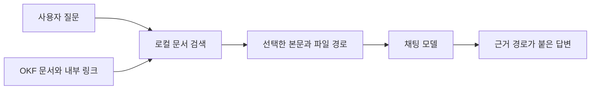

# Open Knowledge Format(OKF) 학습·실습 계획

2026년 11월 17일 확인 · GoogleCloudPlatform 공식 명세 v0.2 기준

## 1. OKF로 무엇을 하는가

OKF는 테이블 스키마, 지표 정의, 운영 절차 같은 지식을 여러 도구가 공유할 수 있게 표현하는 공개 형식이다. 개별 지식은 Markdown 파일 한 개에 담고, 파일의 YAML frontmatter에는 분류와 탐색에 쓸 메타데이터를, 본문에는 설명과 예시를 둔다. 문서 묶음인 번들 전체를 디렉터리로 교환할 수 있다. [OKF 명세 §1–4](https://github.com/GoogleCloudPlatform/open-knowledge-format/blob/main/SPEC.md#1-motivation)

RAG는 질문과 관련된 외부 정보를 찾아 모델의 답변 생성에 제공하는 방식이다. OKF는 그때 찾아 읽을 지식을 표현하는 데 쓸 수 있다. 가령 로컬 검색기가 OKF 파일에서 관련 정책을 찾고 그 본문을 모델에 전달하면 두 가지를 함께 사용한 것이다. 검색·순위화·답변 생성은 소비 도구에서 구현한다. [RAG 원 논문](https://arxiv.org/abs/2005.11401) · [OKF 명세 §1](https://github.com/GoogleCloudPlatform/open-knowledge-format/blob/main/SPEC.md#1-motivation)

## 2. 직접 적용할 v0.2 규칙

| 항목 | 명세에서 확인할 내용 |
| --- | --- |
| 개념 문서 | UTF-8 `.md` 파일, 맨 위의 파싱 가능한 YAML frontmatter, Markdown 본문. 모든 개념에 공통으로 요구되는 키는 비어 있지 않은 `type`이다. `title`, `description`, `resource`, `tags`는 권장 필드다. 주제나 절차처럼 대응하는 자산이 없는 개념에서는 `resource`를 생략할 수 있다. [§4](https://github.com/GoogleCloudPlatform/open-knowledge-format/blob/main/SPEC.md#4-concept-documents) · [§11](https://github.com/GoogleCloudPlatform/open-knowledge-format/blob/main/SPEC.md#11-conformance) |
| 개념 ID와 링크 | ID는 번들 안에서의 경로에서 `.md`를 뺀 값이다. 본문의 일반 Markdown 링크에 번들 루트 기준 `/tables/orders.md` 또는 문서 기준 `../tables/orders.md`를 쓸 수 있다. 관계의 의미는 링크 주변 문맥에 적는다. [§2](https://github.com/GoogleCloudPlatform/open-knowledge-format/blob/main/SPEC.md#2-terminology) · [§6](https://github.com/GoogleCloudPlatform/open-knowledge-format/blob/main/SPEC.md#6-cross-linking-and-paths) |
| 예약 파일 | `index.md`와 `log.md`는 개념 문서에서 쓸 수 없는 예약 이름이며, 각 디렉터리에 선택적으로 둘 수 있다. 인덱스는 제목과 링크 목록으로 탐색을 돕고, 로그는 날짜별 변경 이력을 최신순으로 기록한다. 번들 루트 `index.md`에서만 frontmatter에 `okf_version: "0.2"`를 선언할 수 있다. [§3](https://github.com/GoogleCloudPlatform/open-knowledge-format/blob/main/SPEC.md#3-bundle-structure) · [§8](https://github.com/GoogleCloudPlatform/open-knowledge-format/blob/main/SPEC.md#8-index-files) · [§9](https://github.com/GoogleCloudPlatform/open-knowledge-format/blob/main/SPEC.md#9-log-files) · [§12](https://github.com/GoogleCloudPlatform/open-knowledge-format/blob/main/SPEC.md#12-versioning) |
| 출처 | `sources`는 선택이며, 각 항목을 넣을 때는 `resource`가 필요하다. 근거를 문장 단위로 연결할 때는 본문의 `[^policy]` 같은 각주 라벨과 `sources[].id`를 일치시킨다. [§5.1](https://github.com/GoogleCloudPlatform/open-knowledge-format/blob/main/SPEC.md#51-provenance-sources) |
| 작성·검토·최신성 | `generated`는 작성 주체와 변경 시점을, `verified`는 확인 주체와 시점을 기록한다. 소비자는 `verified`의 단일 매핑과 목록을 모두 읽고, 값의 `human:` 접두사 등을 통해 검토 수준을 파악할 수 있다. `status`를 생략하면 `stable`이 기본이다. 현재 시각이 `stale_after`에 도달하면 오래된 정보로 판단한다. [§5](https://github.com/GoogleCloudPlatform/open-knowledge-format/blob/main/SPEC.md#5-provenance-trust-and-lifecycle) · [§7](https://github.com/GoogleCloudPlatform/open-knowledge-format/blob/main/SPEC.md#7-actor-convention) |
| 소비 도구의 호환성 | 소비자는 알 수 없는 `type`과 추가 필드, 선택 필드 누락, 누락된 인덱스, 끊어진 링크가 있는 번들도 읽을 수 있어야 한다. 예를 들어 실습 도구는 끊어진 링크를 경고로 표시하고 다른 문서는 계속 읽을 수 있다. [§11](https://github.com/GoogleCloudPlatform/open-knowledge-format/blob/main/SPEC.md#11-conformance) |

v0.1 자료로 공부하다가 `timestamp`와 본문의 `# Citations`를 만나면, v0.2에서는 각각 `generated.at`과 `sources`로 대응시킨다. 계산 결과의 실행 증명은 심화 주제다. `Attested Computation`은 승인된 계산과 실행 증빙을 검사하는 방법을 기록하고, 실제 실행과 판정은 소비 도구가 수행한다. [§13](https://github.com/GoogleCloudPlatform/open-knowledge-format/blob/main/SPEC.md#13-changes-from-v01) · [§10](https://github.com/GoogleCloudPlatform/open-knowledge-format/blob/main/SPEC.md#10-attested-computations-concept)

### 자료를 읽는 순서

1. **공개 배경.** Google Cloud의 2026년 6월 발표에서 왜 테이블·지표·절차를 공통 형식에 담으려 했는지 읽는다. 각 필드의 현행 문법은 v0.2 명세에서 확인한다. [Google Cloud 최초 발표](https://cloud.google.com/blog/products/data-analytics/how-the-open-knowledge-format-can-improve-data-sharing)
2. **기본 형식.** 명세의 §2–4, §6, §8–9, §11–12를 읽고, 번들·개념·인덱스의 차이와 내부 링크의 경로 해석을 설명해 본다. [GoogleCloudPlatform OKF v0.2 명세](https://github.com/GoogleCloudPlatform/open-knowledge-format/blob/main/SPEC.md)
3. **실제 문서.** 가상의 소매업 예제 Acme Retail의 `index.md`에서 테이블·지표·정책 디렉터리를 찾아간다. `tables/orders.md`에서 스키마 설명 한 문장을 골라 각주 라벨과 `sources`를 대조한다. [Acme Retail 번들](https://github.com/GoogleCloudPlatform/open-knowledge-format/tree/main/bundles/acme_retail) · [주문 테이블 문서](https://github.com/GoogleCloudPlatform/open-knowledge-format/blob/main/bundles/acme_retail/tables/orders.md)
4. **출처·검토·최신성.** Google Cloud v0.2 발표의 사례를 먼저 읽고 명세 §5·7·13으로 확인한다. 실제 계산 실행까지 다루고 싶을 때 §10과 부록 A로 이어간다. [Google Cloud v0.2 발표](https://cloud.google.com/blog/products/data-analytics/okf-v0-2-adds-trust-signals) · [OKF 명세 §5](https://github.com/GoogleCloudPlatform/open-knowledge-format/blob/main/SPEC.md#5-provenance-trust-and-lifecycle)
5. **도구로 활용.** 공식 저장소의 생성 에이전트와 HTML 시각화 도구를 각각 생산자와 소비자 예로 읽는다. 전체 제작 자동화가 궁금하면 GA4 예제의 입력 자료와 생성된 번들을 비교한다. [공식 구현 README](https://github.com/GoogleCloudPlatform/open-knowledge-format#why-okf) · [GA4 번들 생성 안내](https://github.com/GoogleCloudPlatform/open-knowledge-format/blob/main/samples/ga4_merch_store/README.md) · [생성된 GA4 번들](https://github.com/GoogleCloudPlatform/open-knowledge-format/tree/main/bundles/ga4)

### 블로그·유튜브로 적용 장면 보기

- **1회차 전 · 7분 개념 영상.** Prism Labs 영상의 2:19부터 개념 파일과 번들 구성을 본다. 영상은 v0.1을 다루므로 필드와 파일 규칙은 위 v0.2 명세에서 확인한다. [Prism Labs 입문 영상](https://www.youtube.com/watch?v=14C0E6pwBIQ)
- **2회차 뒤 · 개인 지식 베이스 사례.** 제작자 Marie Haynes의 글에서 문서를 개념·개체·절차로 나눈 폴더와 화면을 살펴보고, 쇼핑몰 실습에 옮겨 쓸 분류를 2개 적어 본다. 인덱스부터 읽게 한 동작은 제작자의 구현 선택이다. [Marie Haynes 적용 글](https://www.mariehaynes.com/build-an-okf-brain-like-mine/)
- **5~6회차 뒤 · SQL 에이전트 사례.** AaiTech 제작자의 영상과 코드에서 주문 데이터와 지표·업무 규칙 문서가 어떤 역할을 하는지 살펴본다. 실습의 파일 기반 답변 흐름이 데이터베이스 질의로 이어지는 사례다. 영상에 한국어 자동 자막이 표시된다. [AaiTech 실습 영상](https://www.youtube.com/watch?v=cfr5Ke7JBqo) · [제작자 예제 코드](https://github.com/Sandesh-hase/aai-food-okf)

## 3. 학습 목표와 목차

Markdown과 Git 사용 경험이 있고, YAML과 RAG는 처음 접해도 따라갈 수 있게 구성했다. 2주 동안 90분씩 6회, 총 9시간을 기준으로 잡았다. 실습은 가상의 쇼핑몰 고객센터 문서로 진행한다. 반품 정책, 환불 절차, 예외 상품처럼 문서 사이의 관계를 질문으로 확인하기 쉬운 소재다.

| 회차 | 읽고 이해할 것 | 직접 할 일 | 완료 기준 |
| --- | --- | --- | --- |
| 1. 포맷과 답변 흐름 | 공식 소개에서 OKF의 목적을 읽고, 파일 구성과 RAG의 검색·생성 단계를 그린다. | 짧은 고객센터 FAQ를 내용, 분류 정보, 다른 문서와의 관계로 표시한다. | 질문이 들어왔을 때 누가 문서를 고르고 어떤 내용이 모델에 전달되는지 설명한다. |
| 2. 첫 OKF 번들 | 공식 예제에서 YAML의 키·값과 목록(`tags`), Markdown 상대 링크를 확인한다. | 반품 정책, 환불 절차, 예외 상품 문서 3개와 탐색용 인덱스를 직접 쓴다. | 인덱스에서 각 문서를 열고, 정책 문서에서 절차와 예외 문서로 이동한다. |
| 3. 작성 규칙과 검증 | 명세의 요구사항과 실습에서 추가한 팀 규칙을 대조한다. | 잘못된 YAML, 끊어진 내부 링크를 하나씩 만들어 검증기가 잡는지 확인한다. 문서 하나를 수정하고 재검증한다. | 잘못된 YAML과 누락된 `type`은 오류로, 끊어진 링크는 경고로 표시한다. |
| 4. 질문별 문서 찾기 | 인덱스, 문서 분류, 본문, 내부 링크가 문서 선택 과정에서 어떻게 쓰이는지 살펴본다. | TypeScript CLI에서 로컬 문서 읽기 → 키워드 매칭 → 관련 문서 링크 한 단계 따라가기를 구현한다. | 질문별로 처음 고른 문서, 링크를 따라 추가한 문서, 선택 이유가 출력된다. |
| 5. 근거를 붙인 답변 | 검색 결과를 모델 입력으로 전달하는 과정을 익힌다. | CLI가 뽑은 문서와 경로를 채팅 모델에 붙여 넣는다. 단일 문서, 두 문서 종합, 근거 없음 질문을 실행한다. | 답변에서 인용한 경로를 열어 사실을 확인할 수 있고, 문서 밖 질문에는 근거 부족을 표시한다. |
| 6. 비교와 확장 | 문서 구조와 검색 설정이 결과에 미치는 영향을 살펴본다. | 같은 질문으로 본문 키워드 검색, 문서 분류를 추가한 검색, 링크를 추가한 검색을 비교한다. | 결과표에 문서 누락, 불필요한 문서 추가, 링크 확장이 유효했던 사례를 남긴다. |

매 회차는 읽기 20분, 실습 50분, 결과 검토와 기록 20분으로 진행한다. 1주 차에는 파일 작성과 검증을 끝내고, 2주 차에는 검색과 답변을 연결한다.

## 4. 완성할 예제 — 반품·환불 질의응답

### 사용자 경험

질문은 “할인 상품을 반품할 수 있나요? 환불은 언제 들어오나요?”로 시작한다. 프로그램이 반품 정책을 찾고 연결된 예외 상품·환불 절차 문서를 추가한다. 모델에는 선택된 본문과 파일 경로를 함께 전달한다. 예시 데이터의 기대 답변은 “할인 상품도 수령 후 7일 이내라면 반품할 수 있습니다. 다만 최종 판매로 표시된 상품은 제외됩니다. 환불은 반품 승인 후 영업일 기준 3~5일 걸립니다.”이며, 각 문장에 해당 근거 파일을 표시한다.

### 실습 파일 설계

| 실습 산출물 | 담을 내용 |
| --- | --- |
| `source/returns-faq.md` | 실습용 원본 FAQ. 아래 세 문서와 동일한 정책 사실을 담는다. |
| `knowledge/index.md` | 번들 목차와 각 문서의 한 줄 설명. |
| `knowledge/policies/returns.md` | 수령 후 7일 이내 신청, 할인 상품에도 적용. 예외 상품과 환불 절차에 링크. |
| `knowledge/policies/return-exceptions.md` | 주문 시 최종 판매 표시 상품은 반품 제외. |
| `knowledge/processes/refunds.md` | 반품 승인 후 영업일 기준 3~5일. |
| `validate.ts` · `retrieve.ts` | 파일 검증과 질문별 문서 검색. 출력에 파일 경로와 선택 이유를 포함한다. |
| `evaluation.md` | 질문별 기대 근거, 실제로 고른 문서, 답변 정확도와 인용 검증 결과. |

### 복사해서 따라가 볼 최소 번들

아래 블록을 `knowledge/` 밑에 표시된 경로대로 저장한다. 상대 링크를 사용하므로 Markdown 미리보기에서 탐색할 수 있다.

**`index.md`**

```markdown
---
okf_version: "0.2"
---

# 반품과 환불

- [반품 정책](policies/returns.md) - 반품 신청 기한과 할인 상품 규칙.
- [반품 예외](policies/return-exceptions.md) - 최종 판매 상품의 처리 기준.
- [환불 절차](processes/refunds.md) - 반품 승인부터 환불까지의 기간.
```

**`policies/returns.md`**

```markdown
---
type: Policy
title: 반품 정책
description: 반품 신청 기한과 할인 상품 규칙.
tags: [반품, 할인]
---

# 반품 조건

할인 상품을 포함해 수령 후 7일 이내에 반품을 신청할 수 있다.
[반품 예외](return-exceptions.md)를 확인한다.
반품 승인 이후의 일정은 [환불 절차](../processes/refunds.md)를 따른다.
```

**`policies/return-exceptions.md`**

```markdown
---
type: Policy
title: 반품 예외
description: 최종 판매 상품의 처리 기준.
tags: [반품, 예외]
---

# 최종 판매 상품

주문할 때 최종 판매로 표시된 상품은 반품할 수 없다.
```

**`processes/refunds.md`**

```markdown
---
type: Process
title: 환불 절차
description: 반품 승인부터 환불까지의 기간.
tags: [환불]
---

# 환불 일정

환불은 반품 승인 후 영업일 기준 3~5일 걸린다.
```

`Policy`와 `Process`는 이 실습에서 고른 타입이다. `index.md`를 열고 반품 정책을 고른 다음 링크 두 개를 따라가면 복합 질문에 필요한 세 근거를 눈으로 확인할 수 있다. 이 번들의 개별 문서, 링크, 루트 인덱스는 공식 명세 §4, §6, §8, §12를 따른다. [OKF v0.2 명세](https://github.com/GoogleCloudPlatform/open-knowledge-format/blob/main/SPEC.md)

### 구현 순서

1. **사람이 먼저 찾아보기.** 인덱스에서 반품 정책을 열고 링크를 따라 필요한 문서를 확인한다. 질문 2개를 직접 풀어 검색 프로그램의 기대 결과를 적는다.
2. **로컬에서 재현하기.** YAML 파서를 사용해 프론트매터와 본문을 읽고, 링크 대상이 번들 안에 존재하는지 검사한다. 인덱스는 탐색에 쓰고 답변 근거는 실제 정책 문서에서 가져온다. 끊어진 링크는 검사 결과에 경고로 남기고 검색은 계속한다. 자동으로 따라갈 링크는 번들 안에서 한 단계로 제한하고 중복 경로는 제거한다.
3. **검색 결과를 모델에 전달하기.** 처음에는 검색한 문서를 직접 붙여 넣어 검색과 생성 각각의 결과를 확인한다. 입력에는 질문과 `경로 + 발췌 본문`을 담고, 지시문은 “제공한 문서 내용으로 답하고 각 정책 주장에 파일 경로를 표시해 줘. 근거가 없으면 번들에서 확인할 수 없다고 답해 줘.”로 시작한다.
4. **검색 설정을 바꿔 비교하기.** 같은 세 문서와 같은 질문을 사용하고, 키워드 매칭 기본 방식, 모델과 지시문을 유지한다. 먼저 본문만 사용하고, 다음에 문서 분류 정보를 더하고, 마지막에 링크 따라가기를 켠다. 입력 문서 수 상한도 동일하게 두고, 필요한 문서를 더 찾았는지와 불필요한 문서가 섞였는지를 같이 본다. 이 결과는 해당 번들과 질문 세트에서의 동작을 설명한다.



### 검증할 질문

| 질문 | 기대 결과와 근거 |
| --- | --- |
| 물건을 받은 지 5일 됐어요. 반품 신청할 수 있나요? | 가능. `returns.md`의 신청 기한. |
| 8일이 지난 할인 상품도 반품할 수 있나요? | 신청 기간 초과. `returns.md`의 기한과 할인 상품 규칙. |
| 할인 상품인데 주문할 때 최종 판매로 표시됐어요. | 반품 제외. `returns.md`의 일반 규칙과 `return-exceptions.md`의 예외. |
| 반품이 승인됐는데 언제 환불되나요? | 승인 후 영업일 기준 3~5일. `refunds.md`. |
| 할인 상품을 반품할 수 있나요? 환불은 언제 들어오나요? | 일반 규칙, 예외, 환불 시점을 함께 설명. 세 문서 모두 필요. |
| 해외 주문 반품 배송비는 누가 부담하나요? | 이 번들에서 확인할 수 없다고 응답. |

질문별로 ① 필요한 문서를 모두 찾았는지, ② 답변이 문서와 일치하는지, ③ 경로를 열었을 때 해당 주장을 뒷받침하는지 표시한다. 마지막 문항은 문서 세트에 없는 정책을 만들어 내지 않았는지 확인한다. 비교 단계에서는 점수와 함께 검색 결과에 포함된 불필요한 문서도 기록한다.

## 5. 첫날 90분

- **20분** — 공식 발표문에서 등장 배경을 읽고, 명세에서 개별 문서 예제와 번들 예제를 찾는다.
- **20분** — 아래 정책 사실로 Markdown FAQ를 한 단락 쓴다. 수령 후 7일, 할인 상품은 신청 가능, 최종 판매 표시는 제외, 승인 후 영업일 기준 3~5일 환불.
- **30분** — FAQ에서 반품 정책 한 문서를 떼어내 공식 문서 예제의 구조에 맞춰 작성한다. 환불 절차와 예외 문서로 연결될 링크 위치를 표시한다.
- **20분** — “질문만 입력”과 “질문에 작성한 문서 본문을 첨부”를 비교한다. 각 답변에서 문서로 확인할 수 있는 문장에 표시한다. 둘째 회차에서 빠진 두 문서와 인덱스를 채운다.

## 6. 기본 실습 뒤에 이어갈 v0.2 학습

1. **원문으로 거슬러 올라가기.** 가상 FAQ를 `type: Reference`를 가진 개념으로 작성해 `references/returns-faq.md`에 저장한다. 반품 정책의 `sources`에 `id: returns-faq`와 `resource: /references/returns-faq.md`를 추가한다. 정책 문장의 각주 라벨 `[^returns-faq]`를 이 ID와 맞춘 뒤 답변 → 정책 문서 → FAQ까지 따라가 본다. 명세 §5.1과 §6.3을 참조한다. [OKF v0.2 명세](https://github.com/GoogleCloudPlatform/open-knowledge-format/blob/main/SPEC.md)
2. **검토 상태와 변경 다루기.** 실제로 사람이 확인한 문서에만 `verified`를 기록한다. 기한이 지난 `stale_after`가 있는 사본으로 검색 결과에 주의를 표시해 본다. 날짜와 검토 신호를 소비자가 어떻게 사용할지는 실습 코드에서 정한다. 명세 §5.2~§5.5를 참조한다. [OKF v0.2 명세](https://github.com/GoogleCloudPlatform/open-knowledge-format/blob/main/SPEC.md)
3. **같은 번들을 다른 방식으로 읽기.** 로컬 CLI와 공식 시각화 도구에서 같은 문서와 링크가 어떻게 표현되는지 비교한다. 이후 테이블·지표 문서로 넘어갈 때 명세 §10의 계산 검증 예제를 읽는다. [공식 구현과 예제](https://github.com/GoogleCloudPlatform/open-knowledge-format) · [OKF v0.2 명세](https://github.com/GoogleCloudPlatform/open-knowledge-format/blob/main/SPEC.md)
