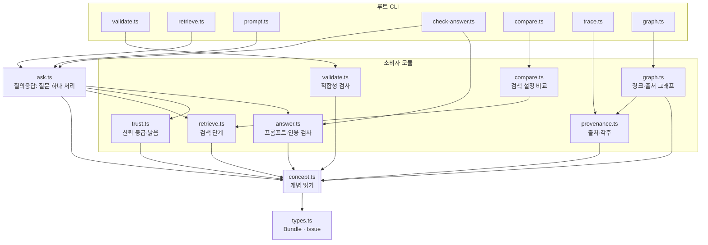
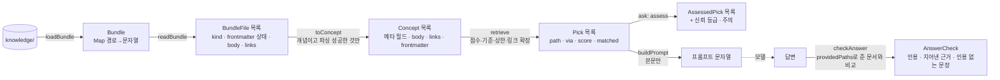
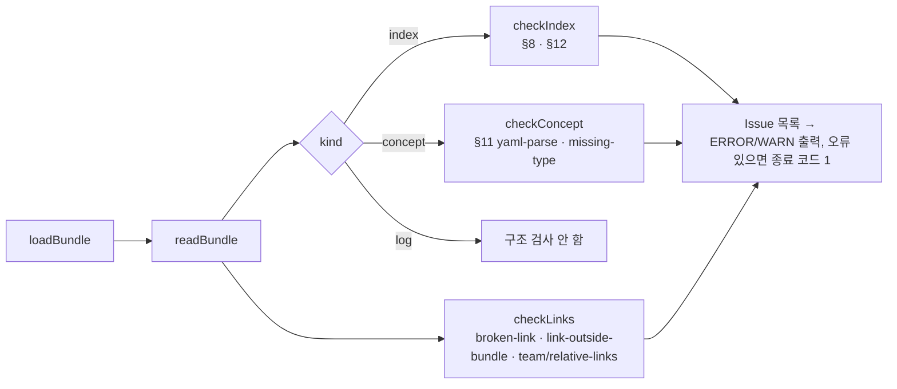
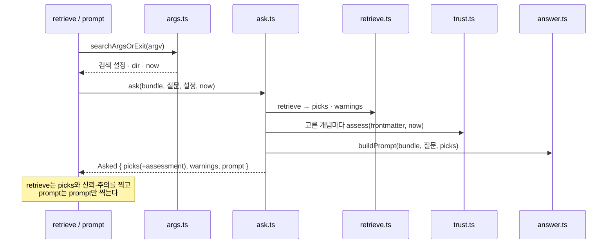
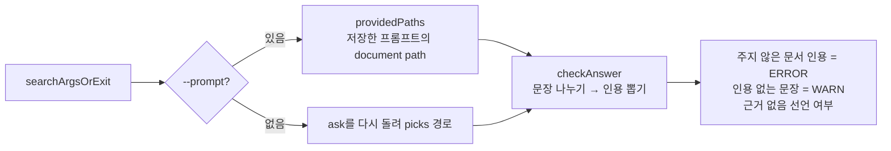
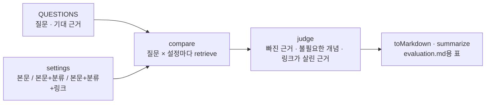
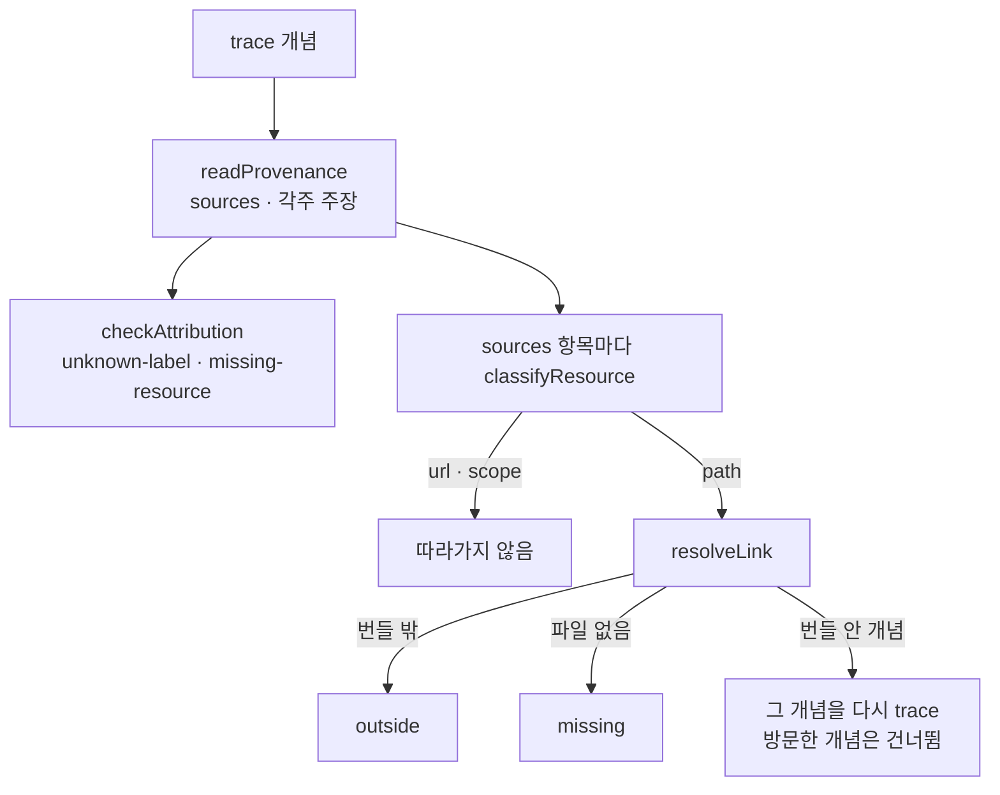
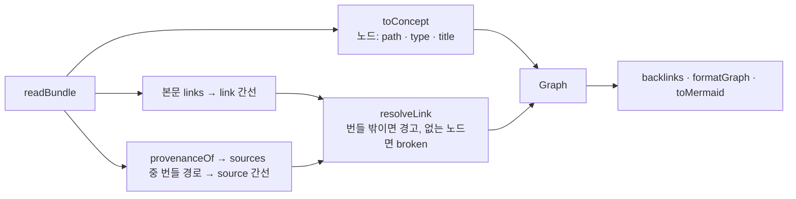

# src/okf 모듈 구조

`src/okf/`의 TS 파일이 각각 무엇을 하고 서로 어떻게 이어지는지 정리한다. 용어는 [GLOSSARY.md](../GLOSSARY.md)를 따른다.

모든 모듈은 파일 시스템을 모른다. 입력은 `Bundle`(번들 루트 기준 경로 → 파일 내용)이고 출력은 값이다. 디스크를 읽는 곳은 `load.ts` 하나, 화면에 찍는 곳은 루트 CLI뿐이다. 그래서 나중의 웹 화면도 같은 모듈을 그대로 쓴다.

## 1. 한눈에 보기

그림에서 뺀 입력 모듈 두 개: 모든 CLI는 `load.ts`(디렉터리 → `Bundle`)로 번들을 읽고, `retrieve`·`prompt`·`check-answer`·`compare`는 `args.ts`(argv → 검색 설정)로 옵션을 검증한다.

아래층일수록 많이 쓰인다. `concept.ts`는 모든 소비자 모듈이 거치는 바닥이다.

## 2. 모듈별 역할

| 파일 | 역할 | 주요 export | 쓰는 모듈 | 회차 |
| --- | --- | --- | --- | --- |
| `types.ts` | 공용 타입. 번들은 `Map<경로, 내용>`이다 | `Bundle`, `Issue`, `Rule`, `Level` | 전부 | 3 |
| `load.ts` | 디렉터리 아래 `.md`를 읽어 `Bundle`로 만든다. 유일하게 디스크를 읽는다 | `loadBundle` | CLI, 실제 번들 테스트 | 3 |
| `concept.ts` | **개념 읽기.** 파일 하나를 frontmatter와 본문으로 나누고 YAML을 한 번 파싱하고 링크를 뽑는다. 예약 파일(`index.md`·`log.md`)을 구분한다 | `readBundle`, `readFile`, `readBundleFile`, `readConcepts`, `toConcept`, `frontmatterData`, `splitFrontmatter`, `resolveLink`, `extractLinks`, `dateText` | 모든 소비자 모듈 | 3·4 (리팩터링으로 모음) |
| `validate.ts` | 명세 §11 적합성 오류와 링크 경고, 팀 규칙 경고를 낸다 | `validateBundle` (+ concept.ts 함수 다시 내보냄) | `validate` CLI | 3 |
| `retrieve.ts` | **검색 단계.** 질문과 개념의 두 글자 묶음(bigram) 겹침으로 점수를 매기고, 기준·상한으로 고른 뒤 링크 확장을 한 단계 한다 | `retrieve`, `score`, `bigrams`, `DEFAULT_OPTIONS`, `Options`, `Pick` | `ask`, `compare`, `args` | 4 |
| `answer.ts` | **생성 단계의 입력과 출력.** 고른 개념의 본문으로 프롬프트를 만들고, 모델 답변의 인용을 검사한다 | `buildPrompt`, `providedPaths`, `checkAnswer`, `extractCitations`, `splitSentences`, `INSTRUCTION` | `ask`, `check-answer` CLI | 5 |
| `compare.ts` | 질문 목록 × 검색 설정 세 가지로 검색을 돌려 기대 근거와 비교한다 (빠진 근거, 불필요한 개념, 링크가 살린 근거) | `compare`, `judge`, `settings`, `QUESTIONS`, `toMarkdown`, `summarize` | `compare` CLI | 6 |
| `provenance.ts` | frontmatter `sources`와 본문 각주를 읽고 서로 맞는지 검사한다. 출처를 따라 원문 개념까지 거슬러 올라간다 | `readProvenance`, `provenanceOf`, `classifyResource`, `checkAttribution`, `trace`, `formatTrace` | `graph`, `trace` CLI | 7 |
| `trust.ts` | 검토 기록(`verified`)으로 신뢰 등급을 정하고, `status`·`stale_after`로 주의를 붙인다. 개념을 빼지 않는다 | `assess`, `normalizeVerified`, `trustTier`, `readFrontmatter`, `formatAssessment` | `ask` | 8 |
| `graph.ts` | 개념을 노드로, 링크와 출처를 간선으로 그래프를 만들고 역링크를 구한다 | `buildGraph`, `backlinks`, `formatGraph`, `toMermaid` | `graph` CLI | 9 |
| `ask.ts` | **질의응답.** 질문 하나에 대해 검색 → 고른 개념마다 신뢰 판정 → 프롬프트까지 한 번에 돌려준다 | `ask`, `Asked`, `AssessedPick` | `retrieve`·`prompt`·`check-answer` CLI | 리팩터링 |
| `args.ts` | CLI 인자를 검색 설정으로 바꾸고 검증한다. 잘못된 상한·기준·fields·시각은 오류로 끝낸다 | `parseSearchArgs`, `searchArgsOrExit` | `retrieve`·`prompt`·`check-answer`·`compare` CLI | 리팩터링 |

## 3. 데이터가 바뀌는 순서

질문 하나가 프롬프트가 되기까지 값의 모양이 이렇게 바뀐다.

- `BundleFile.frontmatter`는 세 상태 중 하나다: `absent`(블록이 없거나 닫히지 않음), `invalid`(YAML 오류 또는 매핑이 아님), `ok`(파싱 결과).
- `Concept.frontmatter`에는 메타 필드 밖의 키(`status`, `verified`, `stale_after`, `sources` …)도 그대로 있다. `ask`는 이것으로 신뢰 판정을 한다.
- 프롬프트에는 frontmatter가 들어가지 않는다. 메타 필드는 검색 단계에서만 쓰고, 근거는 본문에서만 온다.

## 4. CLI별 흐름

### `pnpm validate [dir]`

### `pnpm retrieve "질문"` · `pnpm prompt "질문"`

검색 단계 안쪽(`retrieve.ts`):

1. `readConcepts`로 개념을 읽는다 (인덱스·로그·파싱 실패 제외).
2. 개념마다 `score`: 질문 bigram ∩ 개념 bigram 수. `fields`가 `body+meta`이면 type·title·description·tags도 본다.
3. 기준(`minScore`) 이상을 점수 내림차순·경로순으로 상한(`maxDocs`)까지 고른다.
4. `followLinks`이면 키워드로 고른 개념의 링크만 한 단계 따라가 더한다. 상한을 넘으면 경고만 남긴다.

### `pnpm check-answer "질문" answers/qN.txt [--prompt answers/qN.prompt.txt]`

`--prompt` 없이 돌리면 그 사이 번들이나 설정이 바뀌었을 때 실제로 준 문서와 다를 수 있다. 인용한 파일에 정말 그 내용이 있는지는 사람이 확인한다.

### `pnpm compare [--max --min]`

fields와 링크 확장은 세 설정이 정하므로 `--fields`·`--no-links`는 받지 않는다.

### `pnpm trace policies/returns.md`

### `pnpm graph [--mermaid]`

## 5. 파싱할 수 없는 개념을 다루는 방식

파싱은 `concept.ts`가 한 번 한다. 결과를 어떻게 다룰지는 소비자마다 다르고, 그 차이는 의도다 (`tests/concept.test.ts`가 고정한다).

| 소비자 | frontmatter가 `absent`·`invalid`일 때 |
| --- | --- |
| validate | `yaml-parse` 오류로 보고한다 (§11) |
| retrieve · graph · ask | 개념에서 뺀다. 나머지 개념은 계속 읽는다 (§11) |
| provenance | 출처가 없는 개념으로 다룬다 |
| trust | `readFrontmatter`가 `null`. 호출하는 쪽이 `{}`로 판정하면 unverified다 |

## 6. 링크 해석이 쓰이는 곳

`resolveLink(from, target)`은 `/`로 시작하면 번들 루트 기준, 아니면 개념 위치 기준으로 풀고, 루트 밖이면 `null`이다 (§6.1, §6.2). 네 소비자가 같은 함수를 쓰지만 결과를 읽는 방식은 각자 다르다.

| 소비자 | 대상 | 번들 밖 | 번들에 없음 |
| --- | --- | --- | --- |
| validate | 본문 링크 | `link-outside-bundle` 경고 | `broken-link` 경고 (`dir/index.md`가 있으면 정상) |
| retrieve | 키워드로 고른 개념의 본문 링크 | 경고 후 건너뜀 | 경고 후 건너뜀 |
| graph | 본문 링크 + 번들 경로인 sources | 경고, 간선 없음 | 간선은 만들고 `broken: true` |
| provenance | sources | `outside` | `missing` |

## 7. 테스트

| 테스트 | 대상 |
| --- | --- |
| `tests/concept.test.ts` | 파일 읽기, frontmatter 상태, 소비자별 파싱 실패 처리 |
| `tests/validate.test.ts` | 0003 1~7단계 |
| `tests/retrieve.test.ts` | 0004 bigram·score·retrieve, 실제 번들 기록 |
| `tests/answer.test.ts` | 0005 buildPrompt·checkAnswer |
| `tests/compare.test.ts` | 0006 judge·compare, 실제 번들 기록 |
| `tests/provenance.test.ts` | 0007 checkAttribution·trace |
| `tests/trust.test.ts` | 0008 normalizeVerified·trustTier·assess, 실제 번들 (T4) |
| `tests/graph.test.ts` | 0009 buildGraph·backlinks·toMermaid |
| `tests/ask.test.ts` | 질의응답: 고른 개념별 신뢰 판정, 프롬프트, providedPaths |
| `tests/args.test.ts` | 검색 설정 인자 검증 |

## 8. 바꿀 때 손댈 곳

- **주의를 모델에게도 넘기기 (0008 실습 5단계):** 정책을 정한 뒤 `ask.ts`의 `buildPrompt` 호출 한 곳에서 `AssessedPick.assessment`를 프롬프트에 반영한다. 지금 프롬프트는 0005 그대로다.
- **검색 순위나 원문 개념(`type: Reference`) 처리 바꾸기:** `retrieve.ts`.
- **새 검색 설정 옵션:** `retrieve.ts`의 `Options`와 `args.ts`의 `parseSearchArgs`를 함께 고친다.
- **새 frontmatter 필드 읽기:** `Concept.frontmatter`에서 바로 읽는다. 공통 해석이 필요하면 `concept.ts`에 둔다.
- **웹 화면:** `Bundle`을 브라우저에서 만든 뒤 `ask`, `validateBundle`, `buildGraph`, `trace`를 그대로 부른다. `load.ts`와 `args.ts`만 화면 쪽 adapter로 바꾸면 된다.
