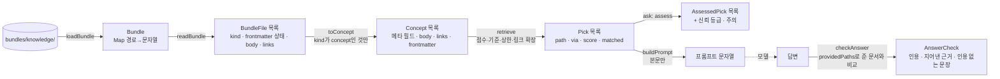
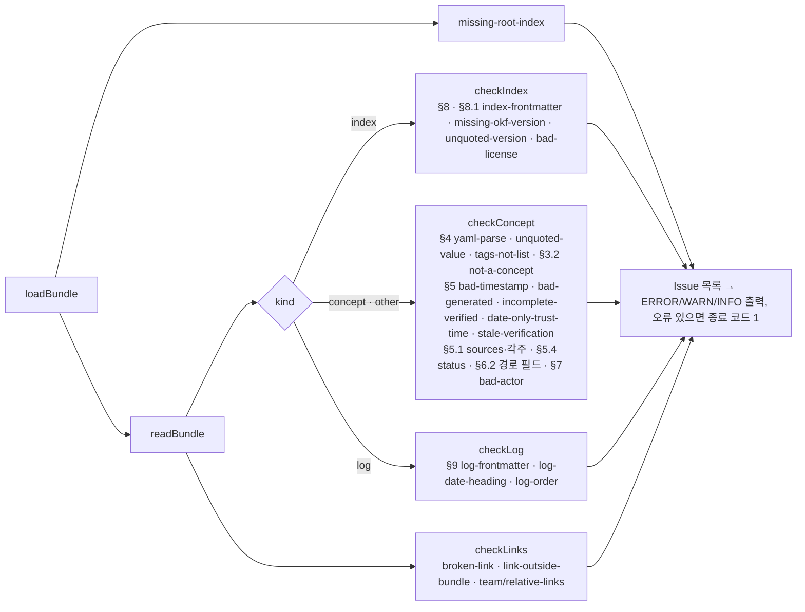
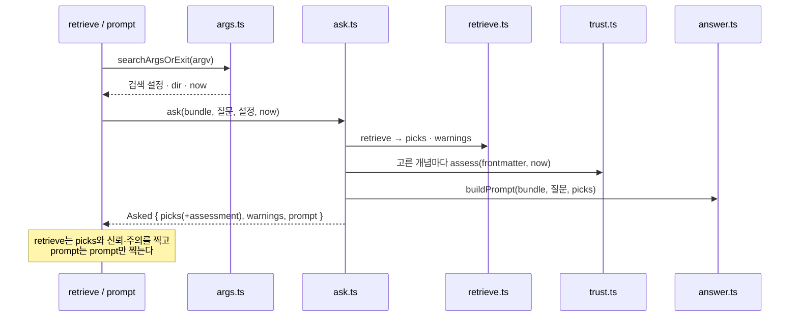
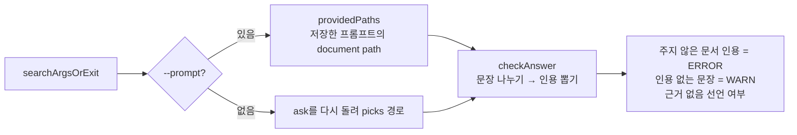
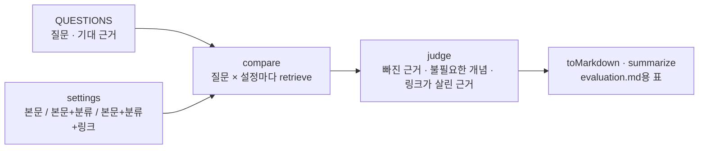
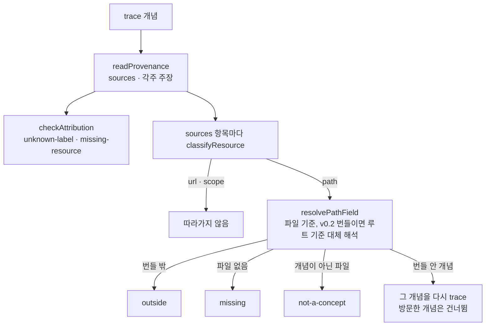
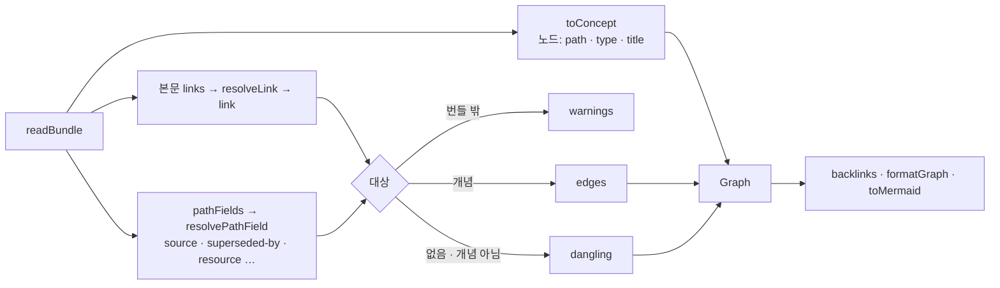

# src/okf 모듈 구조

`src/okf/`의 TS 파일이 각각 무엇을 하고 서로 어떻게 이어지는지 정리한다. 용어는 [GLOSSARY.md](../GLOSSARY.md)를 따른다. 명세 절 번호(§)는 OKF v0.3 기준이다 (2026-11-19 v0.2에서 이전).

`src/okf/`의 검증·검색 함수는 `Bundle`(번들 루트 기준 경로 → 파일 내용)을 받아 결과 값을 돌려준다. CLI는 `load.ts`로 디스크에서 번들을 읽고 웹은 Vite로 번들을 읽는다. 양쪽 모두 같은 OKF 모듈을 호출한다.

## 1. 한눈에 보기

그림에서 뺀 입력 모듈 두 개: 모든 CLI는 `load.ts`(디렉터리 → `Bundle`)로 번들을 읽고, `retrieve`·`prompt`·`check-answer`·`compare`는 `args.ts`(argv → 검색 설정)로 옵션을 검증한다.

아래층일수록 많이 쓰인다. `concept.ts`는 모든 소비자 모듈이 거치는 바닥이다.

## 2. 모듈별 역할

| 파일 | 역할 | 주요 export | 쓰는 모듈 | 회차 |
| --- | --- | --- | --- | --- |
| `types.ts` | 공용 타입. 번들은 `Map<경로, 내용>`이다 | `Bundle`, `Issue`, `Rule`, `Level` | 전부 | 3 |
| `load.ts` | 디렉터리 아래 파일을 `Bundle`로 만든다. `.md`는 내용을 읽고, `.md`가 아닌 파일은 asset이라 경로만 담는다(내용은 빈 문자열, §3.2-3). `.`으로 시작하는 파일·디렉터리는 번들이 아니라 읽지 않는다(§3.2-4). 유일하게 디스크를 읽는다 | `loadBundle` | CLI, 실제 번들 테스트 | 3 |
| `concept.ts` | **개념 읽기.** 파일 하나를 frontmatter와 본문으로 나누고 YAML을 한 번 파싱하고 링크를 뽑는다. 예약 파일(`index.md`·`log.md`)과 개념이 아닌 파일(type 없음, §3.2)을 구분한다. 빈 값·단일 값(§11.2), 시각(§5), 번들 버전(§8.1), 경로 필드와 v0.2 대체 해석(§6.2, §12.1)도 여기서 공통으로 읽는다 | `readBundle`(`.md`만), `readFile`, `readBundleFile`(asset이면 `null`), `isMarkdown`, `readConcepts`, `toConcept`, `conceptType`, `isConceptPath`, `frontmatterData`, `splitFrontmatter`, `resolveLink`, `extractLinks`, `dateText`, `isBlank`, `asList`, `parseTimestamp`, `bundleVersion`, `allowsLegacyPaths`, `classifyResource`, `pathFields`, `resolvePathField` | 모든 소비자 모듈 | 3·4 (리팩터링으로 모음) |
| `validate.ts` | **이 저장소의 검증 기준.** 명세 §11.1 적합성 오류(YAML 파싱, 예약 파일 구조)와, 공식 검증기(`okf-generate`의 `validate.py`)에서 옮긴 경고·정보(행위자 형식, status 어휘, sources·각주, 경로 필드 대상, 시각, 검토 기록이 낡음 …), 팀 규칙 경고를 낸다. Attested Computation 규칙(§10)은 아직 없다 | `validateBundle(bundle, { now? })`, `ValidateOptions` (+ concept.ts 함수 다시 내보냄) | `validate` CLI | 3 |
| `retrieve.ts` | **검색 단계.** 질문과 개념의 두 글자 묶음(bigram) 겹침으로 점수를 매기고, 기준·상한으로 고른 뒤 링크 확장을 한 단계 한다 | `retrieve`, `score`, `bigrams`, `DEFAULT_OPTIONS`, `Options`, `Pick` | `ask`, `compare`, `args` | 4 |
| `answer.ts` | **생성 단계의 입력과 출력.** 고른 개념의 본문으로 프롬프트를 만들고, 모델 답변의 인용을 검사한다 | `buildPrompt`, `providedPaths`, `checkAnswer`, `extractCitations`, `splitSentences`, `INSTRUCTION` | `ask`, `check-answer` CLI | 5 |
| `compare.ts` | 질문 목록 × 검색 설정 세 가지로 검색을 돌려 기대 근거와 비교한다 (빠진 근거, 불필요한 개념, 링크가 살린 근거) | `compare`, `judge`, `settings`, `QUESTIONS`, `toMarkdown`, `summarize` | `compare` CLI | 6 |
| `provenance.ts` | frontmatter `sources`와 본문 각주를 읽고 서로 맞는지 검사한다. 출처를 `resolvePathField`로 풀어 원문 개념까지 거슬러 올라간다 | `readProvenance`, `provenanceOf`, `classifyResource`, `checkAttribution`, `trace`, `formatTrace` | `graph`, `trace` CLI | 7 |
| `trust.ts` | 검토 기록(`verified`) 가운데 `generated.at` 이후의 현재 기록만으로 신뢰 등급을 정하고(§5.3), `status`·`superseded_by`·`stale_after`로 주의를 붙인다. 개념을 빼지 않는다 | `assess`, `normalizeVerified`, `readVerified`, `generatedAt`, `isCurrent`, `trustTier`, `readFrontmatter`, `formatAssessment` | `ask` | 8 |
| `graph.ts` | 개념을 노드로, 개념을 가리키는 링크와 경로 필드(sources·superseded_by·resource …)를 간선으로 그래프를 만들고(§6.4) 역링크를 구한다. 개념을 가리키지 않는 참조는 `dangling`에 둔다 | `buildGraph`, `backlinks`, `formatGraph`, `toMermaid` | `graph` CLI | 9 |
| `request.ts` | **웹 화면의 모델 요청 조립.** 고른 개념의 본문, 말투 설정, 오늘 날짜, 질문으로 모델 요청(system = 지시문 + 말투 설정, user = 날짜 + 문서 + 질문)을 만들고 요청 조립 기록을 남긴다. 고른 개념이 없으면 모델 요청을 만들지 않는다. SDK를 모른다 | `buildModelRequest`, `formatToday`, `MODEL_INSTRUCTION`, `ModelRequest`, `AssemblyRecord`, `AssemblyStep`, `VoiceGuide` | 웹 `features/qa/prepareRun.ts` | 웹 화면 |
| `ask.ts` | **질의응답.** 질문 하나에 대해 검색 → 고른 개념마다 신뢰 판정(deprecated면 대체 경로 해석) → 프롬프트까지 한 번에 돌려준다 | `ask`, `Asked`, `AssessedPick`, `Replacement` | `retrieve`·`prompt`·`check-answer` CLI | 리팩터링 |
| `args.ts` | CLI 인자를 검색 설정으로 바꾸고 검증한다. 잘못된 상한·기준·fields·시각은 오류로 끝낸다 | `parseSearchArgs`, `searchArgsOrExit` | `retrieve`·`prompt`·`check-answer`·`compare` CLI | 리팩터링 |

## 3. 데이터가 바뀌는 순서

질문 하나가 프롬프트가 되기까지 값의 모양이 이렇게 바뀐다.

- `BundleFile.frontmatter`는 세 상태 중 하나다: `absent`(블록이 없음), `invalid`(닫는 `---` 없음, YAML 오류, 매핑이 아님), `ok`(파싱 결과).
- `BundleFile.kind`는 넷 중 하나다: `index`·`log`(예약 파일, §3.1), `concept`(frontmatter가 `ok`이고 비어 있지 않은 문자열 `type`이 있음), `other`(그 밖의 `.md`. 개념이 아니다, §3.2).
- `Concept.frontmatter`에는 메타 필드 밖의 키(`status`, `verified`, `stale_after`, `sources` …)도 그대로 있다. `ask`는 이것으로 신뢰 판정을 한다.
- 프롬프트에는 frontmatter가 들어가지 않는다. 메타 필드는 검색 단계에서만 쓰고, 근거는 본문에서만 온다.

## 4. CLI별 흐름

루트의 `pnpm <명령>`은 `package.json`을 통해 `cli/<명령>.ts`를 실행한다. CLI가 인자를 읽고 `src/okf/`의 함수를 호출한 뒤 결과를 터미널에 출력한다. 번들과 답변 파일의 상대 경로는 저장소 루트 기준이다.

### `pnpm validate [dir]`

### `pnpm retrieve "질문"` · `pnpm prompt "질문"`

검색 단계 안쪽(`retrieve.ts`):

1. `readConcepts`로 개념을 읽는다 (인덱스·로그·type 없는 파일·파싱 실패 제외).
2. 개념마다 `score`: 질문 bigram ∩ 개념 bigram 수. `fields`가 `body+meta`이면 type·title·description·tags도 본다.
3. 기준(`minScore`) 이상을 점수 내림차순·경로순으로 상한(`maxDocs`)까지 고른다.
4. `followLinks`이면 키워드로 고른 개념의 링크만 한 단계 따라가 더한다. 대상이 개념이 아니면(번들에 없음, type 없음) 경고하고 건너뛴다. 상한을 넘으면 경고만 남긴다.

`ask`는 고른 개념마다 `assess`를 부르고, `status: deprecated`에 `superseded_by`가 있으면 `resolvePathField`로 풀어 `replacement`에 담는다. 대체 개념을 검색 결과에 더하지는 않는다. `retrieve` CLI는 `대체 개념:` 줄로 보여 준다.

### `pnpm check-answer "질문" answers/qN.txt [--prompt answers/qN.prompt.txt]`

`--prompt` 없이 돌리면 그 사이 번들이나 설정이 바뀌었을 때 실제로 준 문서와 다를 수 있다. 인용한 파일에 정말 그 내용이 있는지는 사람이 확인한다.

### `pnpm compare [--max --min]`

fields와 링크 확장은 세 설정이 정하므로 `--fields`·`--no-links`는 받지 않는다.

### `pnpm trace policies/returns.md`

### `pnpm graph [--mermaid]`

## 5. 개념이 아닌 파일과 파싱할 수 없는 파일을 다루는 방식

파싱은 `concept.ts`가 한 번 한다. 결과를 어떻게 다룰지는 소비자마다 다르고, 그 차이는 의도다 (`tests/concept.test.ts`가 고정한다).

| 소비자 | frontmatter가 `invalid`일 때 | frontmatter가 `absent`이거나 `type`이 없을 때 |
| --- | --- | --- |
| validate | `yaml-parse` 오류 (§4, §11.1) | `not-a-concept` 경고. 적합성에는 영향 없음 (§3.2) |
| retrieve · graph · ask | 개념에서 뺀다. 나머지 개념은 계속 읽는다 | 개념에서 뺀다 (§3.2) |
| provenance | 출처가 없는 개념으로 다룬다 |
| trust | `readFrontmatter`가 `null`. 호출하는 쪽이 `{}`로 판정하면 unverified다 |

## 6. 링크·경로 필드 해석이 쓰이는 곳

`resolveLink(from, target)`은 `/`로 시작하면 번들 루트 기준, 아니면 파일이 있는 디렉터리 기준으로 풀고, 루트 밖이면 `null`(외부)이다 (§6). 링크와 경로 필드가 같은 규칙을 쓴다.

경로 필드(`resource`, `sources[].resource`, `superseded_by`, `computation`, `executor.resource`, `attester.resource`, §6.2)는 `resolvePathField(bundle, from, value)`로 푼다. 규칙은 `resolveLink`와 같고, 하나를 더한다: `/` 없는 값이 파일 기준으로 번들에 없고, 번들이 `okf_version` 0.2 이하이거나 선언이 없으면(`allowsLegacyPaths`) 번들 루트 기준으로 다시 찾는다(`legacy: true`, §6.2, §12.1). 본문 링크에는 이 대체 해석을 쓰지 않는다.

| 소비자 | 대상 | 번들 밖 | 번들에 없음 · 개념 아님 |
| --- | --- | --- | --- |
| validate | 본문 링크 | `link-outside-bundle` 경고 | `broken-link` 경고 (`dir/index.md`가 있으면 정상) |
| retrieve | 키워드로 고른 개념의 본문 링크 | 경고 후 건너뜀 | 경고 후 건너뜀 |
| graph | 본문 링크 + 모든 경로 필드 | 경고, 간선 없음 | 간선 없음, `dangling`에 `missing`·`not-a-concept` |
| provenance | sources (`resolvePathField`) | `outside` | `missing` · `not-a-concept` |
| ask | `superseded_by` (`resolvePathField`) | `replacement.target: null` | `replacement.concept: false` |

## 7. 테스트

| 테스트 | 대상 |
| --- | --- |
| `tests/concept.test.ts` | 파일 읽기, frontmatter 상태, kind, 소비자별 파싱 실패 처리, 빈 값·단일 값, 시각, 번들 버전, 경로 필드·대체 해석, 점 경로, asset |
| `tests/validate.test.ts` | 0003 1~7단계 (4단계는 v0.3 규칙), 8단계 공식 검증기에서 옮긴 규칙 |
| `tests/retrieve.test.ts` | 0004 bigram·score·retrieve, 실제 번들 기록 |
| `tests/answer.test.ts` | 0005 buildPrompt·checkAnswer |
| `tests/compare.test.ts` | 0006 judge·compare, 실제 번들 기록 |
| `tests/provenance.test.ts` | 0007 checkAttribution·trace |
| `tests/trust.test.ts` | 0008 normalizeVerified·trustTier·assess, 실제 번들 (T4) |
| `tests/graph.test.ts` | 0009 buildGraph·backlinks·toMermaid, 경로 필드 간선·dangling·대체 해석 |
| `tests/ask.test.ts` | 질의응답: 고른 개념별 신뢰 판정, 대체 경로, 프롬프트, providedPaths |
| `tests/args.test.ts` | 검색 설정 인자 검증 |
| `tests/request.test.ts` | 웹 화면의 모델 요청 조립: system/user 분리, 말투 설정 켜기·끄기, 날짜, 순서, 모델 요청 생략 |
| `tests/claude-protocol.test.ts` | 생성 이벤트 프로토콜 (`shared/claude/protocol.ts`): 인코딩·디코딩 왕복(청크 경계), error·중간 끊김, 요청 검증 |
| `tests/server.test.ts` | 로컬 API 서버 (`server/app.ts`): 가짜 생성기로 스트림·400·413·503·연결 끊김, SDK 메시지 → 생성 결과 매핑 |
| `tests/web-citations.test.ts` | 웹 화면의 인용 칩 준비 (`web/src/features/qa/citations.ts`) |
| `tests/web-bundles.test.ts` | 웹 화면의 번들 자동 탐색: 디렉터리별 묶기, 점 디렉터리 제외, 정렬 (`web/src/lib/bundles/groupByBundle.ts`) |

## 8. 바꿀 때 손댈 곳

- **주의를 모델에게도 넘기기 (0008 실습 5단계):** 정책을 정한 뒤 `ask.ts`의 `buildPrompt` 호출 한 곳에서 `AssessedPick.assessment`를 프롬프트에 반영한다. 지금 프롬프트는 0005 그대로다.
- **검색 순위나 원문 개념(`type: Reference`) 처리 바꾸기:** `retrieve.ts`.
- **새 검색 설정 옵션:** `retrieve.ts`의 `Options`와 `args.ts`의 `parseSearchArgs`를 함께 고친다.
- **새 frontmatter 필드 읽기:** `Concept.frontmatter`에서 바로 읽는다. 빈 값은 `isBlank`, 목록 필드는 `asList`, 시각은 `parseTimestamp`로 읽는다. 공통 해석이 필요하면 `concept.ts`에 둔다.
- **새 경로 필드:** `concept.ts`의 `PathFieldName`·`pathFields`와 `graph.ts`의 `FIELD_KIND`를 함께 고친다.
- **웹 화면 (`web/`):** 브라우저는 `load.ts`·`args.ts`를 가져오지 않는다. 번들은 `web/src/lib/bundles/loadBundles.ts`가 `import.meta.glob`으로 `Bundle`을 만들고, 질문 하나는 `features/qa/prepareRun.ts`가 `ask` → `buildModelRequest` 순서로 조립한 뒤 `lib/claude/generate.ts`가 Vite 프록시를 통해 Express의 `POST /api/generate`를 호출한다. Express는 Claude SDK를 실행하고 NDJSON으로 텍스트와 최종 결과를 보낸다. NDJSON 인코딩·디코딩과 요청 검증은 `shared/claude/protocol.ts` 하나를 서버와 브라우저가 같이 쓴다. 연결이 끊기면 SDK 요청도 취소한다. 브라우저가 `checkAnswer`로 인용을 검사한다.
- **Claude 모델 설정과 요청 형식:** `shared/claude/`에 모델 ID, 생성 옵션, 요청 변환, 스트림 이벤트 타입을 둔다. 웹의 디버깅 미리보기와 Express의 실제 호출이 같은 `toApiRequest()`를 사용한다. 화면별 기본 모델과 표시 이름·설명은 `web/src/config/models.ts`에 둔다. Claude SDK 호출과 API 키는 `server/`에서 처리한다. 생성기 seam은 `Generate` 타입(`shared/claude/types.ts`)이다. 서버 `createApp({ generate })`는 SDK adapter(`server/index.ts`) 또는 테스트용 가짜를 받고, 키가 없으면 `null`을 받아 503을 돌려준다.
- **번들 추가:** `bundles/<이름>/`를 만들고 `index.md`에 `okf_version`을 넣는다. 웹 화면은 `bundles/*/`를 glob 하나로 읽어 디렉터리별로 나누고(`web/src/lib/bundles/groupByBundle.ts`), `okf_version`이 없는 디렉터리는 건너뛴다. 화면 이름·설명은 `index.md`의 `title`·`description`이다. 예시 질문·말투 설정만 `web/src/config/bundles.ts`의 `BUNDLE_SETTINGS`에 적는다. CLI는 `--dir bundles/<이름>`으로 고른다.
- **웹 지시문·말투 규칙 바꾸기:** `request.ts`의 `MODEL_INSTRUCTION`. 0005의 `INSTRUCTION`(CLI용)은 그대로 둔다.
